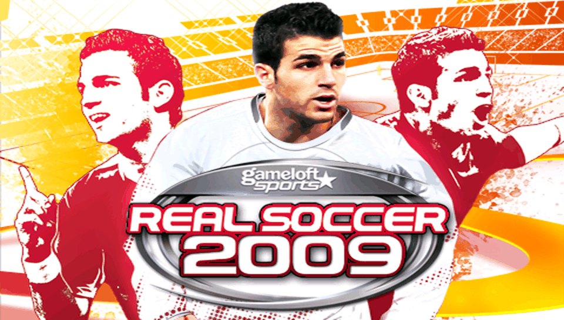

<h1 align="center">
  <br>
  Real Soccer 2009 · PS Vita Port
</h1>

<p align="center">
  <b>Native port of Real Soccer 2009 (Gameloft) for PlayStation Vita and PlayStation TV.</b>
</p>

<p align="center">
  
  
  
  
  
  
</p>

<p align="center">
  <a href="#-description">Description</a> •
  <a href="#-features">Features</a> •
  <a href="#-controls">Controls</a> •
  <a href="#-installation">Installation</a> •
  <a href="#-known-issues">Known Issues</a> •
  <a href="#-building-from-source">Build</a> •
  <a href="#-credits">Credits</a>
</p>

---

## 📖 Description

An unofficial, native **iOS-to-PS Vita wrapper port** of *Real Soccer 2009* (iOS v1.5.7, originally developed by
**Gameloft**). There is no `.so` here. This port ships its own **Mach-O loader** and **Objective-C runtime** that map the
official armv6 iOS executable (`RF09`, from the 1.5.7 IPA) into PS Vita RAM and replace the Apple frameworks it uses with
native implementations on top of **vitaGL**, **openal-soft** and the Vita system libraries.

### Loader architecture

- **Mach-O loader** (`source/macho.c`): loads the armv6 executable at a fixed base (`MACHO_SLIDE = 0x98000000`), with rebase and
  bind data generated from the IPA by `tools/ios_prep.py`.
- **ABI rules**: `r9` is scratch on iOS (the loader is built with `-ffixed-r9`), floats travel in integer registers (vitaGL
  is built with `SOFTFP_ABI=1`), and iOS code uses 4-byte stack alignment (realigned by `ml_align_call`).
- **FairPlay**: the executable must be decrypted (`cryptid 0`).

---

## 🎮 Status & Playability

**Status: Playable (beta)**

On physical PlayStation Vita hardware the game runs from the menus into friendly matches at about 25 FPS, with music,
sound effects and physical controls.

- [x] **Mach-O loader**: loads the armv6 executable at a fixed base (`MACHO_SLIDE = 0x98000000`), with rebase and bind data
  generated from the IPA by `tools/ios_prep.py`. *Verified on console.*
- [x] **Graphics**: GLES 1.x → **vitaGL** (`SOFTFP_ABI=1`). The game runs as an iPhone (480x320, landscape) and is shown at
  816x544 with side borders, keeping the aspect ratio (`PORT_STRETCH 0`). Full screen can be selected in the options menu.
  *Verified on console.*
- [x] **Audio**: sound effects through OpenAL and music through AudioQueue (the seven `.m4a` tracks converted to `.ogg`).
  *Verified on console.*
- [x] **Touch & Controls**: the front touchscreen acts as the iPhone screen, the left stick drives a virtual stick on the pad,
  and the physical buttons press on-screen buttons (see [Controls](#-controls)). *Verified on console.*
- [x] **Pause and sound fixes**: the pause transition and the sound-effect buffer handling were fixed during console testing.
  *Verified on console.*
- [x] **Options menu** (Select + Start): button remap, on-screen controls, screen size, filter, MSAA, FPS counter and limit,
  rotation. See [Port options](#port-options-select--start). *Not tested on console yet.*
- [ ] **Trophies**: not implemented.

### Changelog

- **2026-11-07, run 015**: playable at about 25 FPS in a match. Fixes from the console runs: the left stick uses a radial
  dead zone of 0.35 (the virtual finger was held by stick drift), the pause transition no longer raises OpenAL errors every
  frame (`alSourceStop` before unqueue), and `.ogg` files are opened with `ov_open` and a 64 KB buffer.

---

## ✨ Features

| Feature | Status | Notes |
| :--- | :---: | :--- |
| Boots to gameplay | ✅ | Menus into friendly matches (verified on console). |
| Graphics / renderer | ✅ | vitaGL, GLES 1.x, 816x544 with side borders; full screen in the options menu (verified on console). |
| Audio & music | ✅ | Sound effects through OpenAL, music through AudioQueue (verified on console). |
| Video / cutscenes | ➖ | The IPA has no video files, so none are played. |
| Physical buttons | ✅ | Cross (shoot) and Square (pass) verified; other buttons see Controls. |
| Analog sticks / camera | ✅ | Left stick drives a virtual stick on the pad. |
| Touch screen | ✅ | Front touchscreen acts as the iPhone screen (verified on console). |
| Button remapping / port menu | 🧪 | Options menu not tested on console yet. |
| Save data | 🧪 | `Documents/` folder for save games; <!-- TODO: confirm persistence -->. |
| Native trophies | ❌ | Not implemented. |
| Languages | ❔ <!-- TODO --> | Not documented in this repo. |
| Performance | ✅ | About 25 FPS in matches (verified on console). |
| Online / IAP / ads | ➖ | Reachability, sockets and the IGP menu are stubbed (offline). |
| PS TV | 🧪 | Same VPK; not tested on PS TV. |

Legend: `✅ Working (verified on console) · 🧪 Implemented, not yet verified on console · 🟡 Partial · ❌ Not working · ➖ Not applicable · ❔ Not documented yet`

---

## 🎯 Controls

Physical buttons are translated into touches at fixed points of the screen. The points are set in
`ux0:data/realsoccer09/controls.txt` (coordinates on the 480x320 screen) and can be changed without recompiling.

| Input | Action | Status |
| :---: | :--- | :---: |
| **Front Touchscreen** | iPhone touch screen (menus, HUD) | ✅ Working |
| **Left Stick** | Virtual stick on the match pad (movement) | ✅ Working |
| **Cross (✖)** | Shoot (`controls.txt`: `CROSS 430 270 Shoot`) | ✅ Working |
| **Square (◼)** | Pass (`controls.txt`: `SQUARE 330 270 Pass`) | ✅ Working |
| **Circle (●)** | On-screen button at `50 270` <!-- TODO: confirm action name --> | ❔ <!-- TODO: confirm in game --> |
| **Triangle (▲)** | On-screen button at `430 50` <!-- TODO: confirm action name --> | ❔ <!-- TODO: confirm in game --> |
| **Start** | On-screen button at `240 160` <!-- TODO: confirm action name --> | ❔ <!-- TODO: confirm in game --> |
| **Select + Start** | Options menu (see below) | ⚠️ Not tested on console |
| **L + R** | Show/hide the game's on-screen touch controls (they keep working) | ⚠️ Not tested on console |

### ⚙️ Port options (Select + Start)

Hold **Select + Start** in game to open the options menu. The game stays paused behind a translucent panel. **Up / Down**
moves between rows, **X** changes the selected row (or assigns a new button), **Left / Right** cycles a setting,
**Triangle** clears a button, and **Circle** or **Start** closes the menu and saves.

| Row | Values | Notes |
| :--- | :--- | :--- |
| One row per `controls.txt` action | the button(s) bound to it | **X**, then press the new button. If another action already uses that button, the two actions swap. **Triangle** leaves the action with no button. **Start** cancels the capture. |
| On-screen controls (L+R) | SHOWN / HIDDEN | Same as **L+R** in game. Hidden controls keep responding to touch. |
| Screen size | FULL SCREEN / ORIGINAL ASPECT | Default: original aspect (816x544 with side borders). |
| Screen filter | BILINEAR (SMOOTH) / SHARP BILINEAR | Default: sharp. The `pixel` filter exists in the code but is only offered when the port is built with `PORT_2D`, which this port is not. |
| Anti-aliasing (MSAA) | OFF / 2X / 4X | Applies after restarting the game. |
| FPS counter | OFF / ON | Top-left corner of the screen. |
| FPS limit | OFF (GAME) / 30 FPS | |
| Rotation | NONE / LANDSCAPE RIGHT / LANDSCAPE LEFT | Default: landscape right (`Info.plist` orientation). Use it if the picture is turned. |

Settings are saved to `ux0:data/realsoccer09/options.txt` (the button bindings go to `controls.txt`). The file can be edited by
hand: `filter=bilinear|sharp`, `msaa=0|2|4`, `stretch=0|1` (1 = full screen), `show_fps=0|1`, `fps_cap=0|30`, `hud_hidden=0|1`,
`rotation=0|1|2`.

---

## 📋 Prerequisites

1. PS Vita / PS TV on Custom Firmware (**Enso 3.60 / 3.65** recommended), with `kubridge` under `*KERNEL` in `ur0:tai/config.txt`:
   ```ini
   *KERNEL
   ur0:tai/kubridge.skprx
   ```
2. **libshacccg.suprx** in `ur0:data/` (extract it with **ShaRKBR33D**).
3. A decrypted **Real Soccer 2009 1.5.7** iOS `.ipa` (FairPlay `cryptid 0`, MinimumOSVersion 2.2.1). Other versions will not match `rebase.bin`.

---

## 📦 Installation

1. Open the `.ipa` as a ZIP and extract the `.app` folder (`Payload/<App>.app/`).
2. Stage the data with `tools/stage_data.sh` (see Building). It copies the `.app`, generates `rebase.bin`, `binds.bin` and
   `nib.txt`, and converts the music to `.ogg`.
3. Copy the result to the Vita (`ux0:data/realsoccer09/`):
   ```
   ux0:data/realsoccer09/
     game_app/      the contents of the .app folder (executable, data, converted music), renamed to game_app
     rebase.bin     rebase table generated from the executable
     binds.bin      binding table generated from the executable
     nib.txt        MainWindow.nib, precompiled
     controls.txt   button positions, editable over FTP
     Documents/     created automatically — your save games
     logs/          created automatically — realsoccer09_NNN.log, one per run
   ```
4. Install `realsoccer09.vpk` (Title ID `PSVRS0009`, version `01.00`) with VitaShell.

---

## 🐛 Known Issues

- **Frame rate**: about 25 FPS in matches; the game's own loop sets the pace.
- **Button positions**: the default positions in `controls.txt` were calibrated on console; adjust them if a button does not respond.
- **Intro videos**: the IPA has no video files, so none are played.
- **Online features disabled**: reachability, sockets and the IGP menu are stubbed (offline).
- **Logs and crash dumps**: runtime logs are in `ux0:data/realsoccer09/logs/`. Crash dumps are written by the system to `ux0:data/`,
  not to the game folder.

---

## 🔨 Building from Source

### Prerequisites

- [VitaSDK](https://vitasdk.org/) (`$VITASDK`, softfp) with `vitaGL` (vendored, built with `SOFTFP_ABI=1`), `vitashark`,
  `openal-soft` (with `libvorbis`) and `SceShaccCgExt`.
- CMake 3.14+, Python 3 (for the tools).
- The decrypted `.app` folder, linked as `game_app` in the repo root (never committed).

### Compilation Commands

```bash
git clone https://github.com/MetalSyntax/Real-Soccer-2009-vita.git
cd Real-Soccer-2009-vita
ln -s /path/to/Payload/<App>.app game_app

# Stage the console data: copies the .app, generates rebase.bin / binds.bin / nib.txt, converts music to .ogg
tools/stage_data.sh

# Build eboot.bin / realsoccer09.vpk
cmake -S . -B build
cmake --build build
```

### Deploy & Debug (over VitaShell FTP)

```bash
python3 -I tools/deploy_data.py          # incremental upload of ux0_data/realsoccer09/
python3 -I tools/deploy_data.py --logs   # fetch logs and crash dumps into ./logs/
```

A crash PC in `0x98xxxxxx` minus `0x98000000` is the address in the Mach-O: look it up with `python3 -I tools/annotate.py`.
Architecture and progress notes: [`PORTING_PLAN.md`](PORTING_PLAN.md) and [`port_progress.md`](port_progress.md).

---

## 📁 Project Structure

- `source/`: native loader: Mach-O loader, ABI glue, Darwin and ObjC runtime, GLES, audio, input, options.
- `tools/`: staging, deploy and analysis scripts (`stage_data.sh`, `ios_prep.py`, `deploy_data.py`, `annotate.py`).
- `vendor/vitaGL/`: vitaGL built from source (`SOFTFP_ABI=1`).
- `extras/livearea/`: LiveArea assets (`pic0.png` is the banner).
- `ux0_data/realsoccer09/`: staged data for the console.
- `PORTING_PLAN.md`: living plan: binary facts, frameworks, phases.
- `port_progress.md`: bug-by-bug progress log.

---

## 📜 Disclaimer

**Real Soccer** is a registered trademark of **Gameloft**. The work presented in this repository is unofficial and is not
produced, endorsed, or sanctioned by Gameloft or any affiliated entities.

This software does NOT contain original game code, binaries, copyrighted graphics, or game assets. The authors do not promote
or condone piracy in any way. To play, you must provide your own legally obtained, **decrypted** copy of the iOS `.ipa`.

---

## ☕ Support My Work

This project is **free** and will stay free. If you enjoy it, a tip from **$1** helps me keep porting games to the PS Vita:

<p align="center">
  <a href="https://ko-fi.com/metalsyntax"></a>
</p>

- **Ko-fi:** [ko-fi.com/metalsyntax](https://ko-fi.com/metalsyntax)
- **PayPal:** [paypal.me/MetalSyntax](https://paypal.me/MetalSyntax)
- **Bitcoin (BTC):** `133HdCsaWxdjTfmwpgGVykByhNBV338uRc`

**Ko-fi supporters get:**
- **Early access** to new ports before their public release (test builds of upcoming projects).
- **Data preparation scripts and step-by-step guides** to set up your own game files for each new port.
- A say in which games I port next.

> Game files are never distributed. You always need your own legally obtained copy of the game.

---

## 👥 Credits

- **Real Soccer 2009** is intellectual property of **Gameloft**.
- **MetalSyntax**: this port.
- **vitaGL** graphics library by [Rinnegatamante](https://github.com/Rinnegatamante/vitaGL).
- **kubridge** plugin by [Bythos](https://github.com/bythos14/kubridge).
- **openal-soft**, **libvorbis**, **FreeType** and **libpng** projects.
- The **iOS Mach-O loader** is based on [`ios-loader-boilerplate`](https://github.com/MetalSyntax/ios-loader-boilerplate) and [`Inotia2-vita`](https://github.com/MetalSyntax/Inotia2-vita).
- The PS Vita homebrew and porting community.

---

## 📄 License

<!-- TODO: no LICENSE file in this repository. Add the license text and holder before publishing. -->
